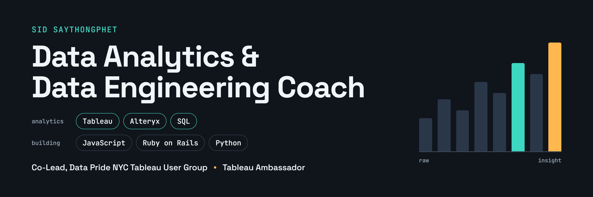

# 👋 Hello!

I help people get better at data. I coach analytics and data engineering, which usually means a lot of Tableau, Alteryx, and SQL, and a lot of “okay, let’s look at what this data is actually telling us.” My goal is to empower aspiring data professionals to upskill and build real confidence in this career.

I got here a slightly odd way. I started in fitness and wellness, with an arts background underneath that. In 2023 I switched to data, and it turns out coaching someone through a new lift and coaching them through a new query have a lot in common. Nobody gets strong from one big workout, and nobody gets good at SQL in one weekend of tutorials. It’s small reps, done often, with someone in your corner.

I co-lead the Data Pride NYC Tableau User Group and I’m a Tableau Ambassador, which is a very official way of saying I really enjoy nerding out about dashboards with other people. Most of what I know, I learned from someone who shared it, so I try to pay that forward.

I also have built things in JavaScript, Ruby on Rails, and a little Python. The “little” is honest.

If you’re stuck on a calc, a query, or a chart that just won’t look right, send me a message. I like those problems!

<!---
SidSaythongphet/SidSaythongphet is a ✨ special ✨ repository because its `README.md` (this file) appears on your GitHub profile.
You can click the Preview link to take a look at your changes.
--->
